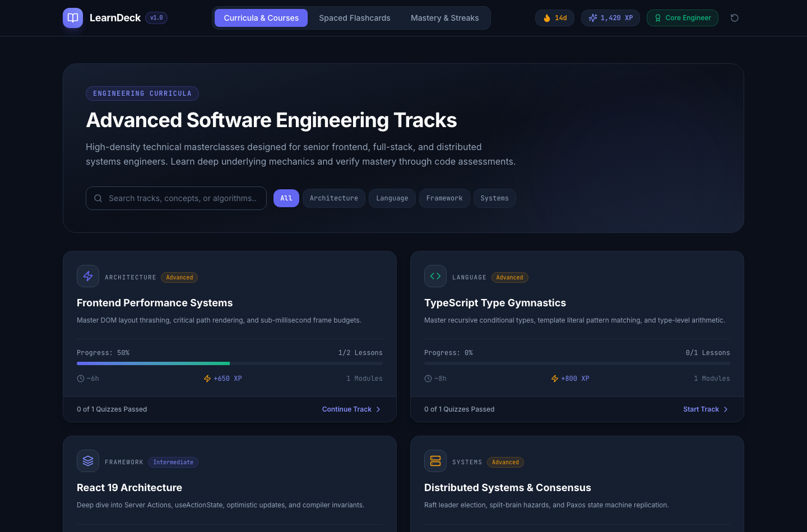
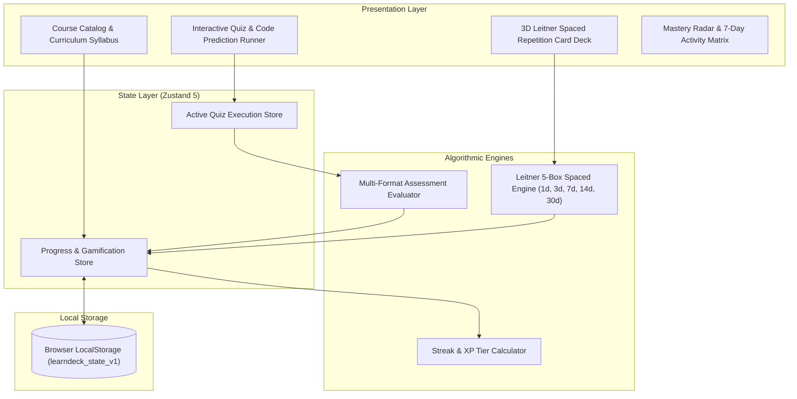
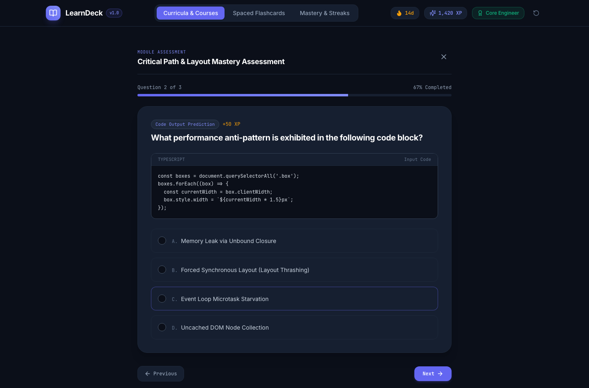
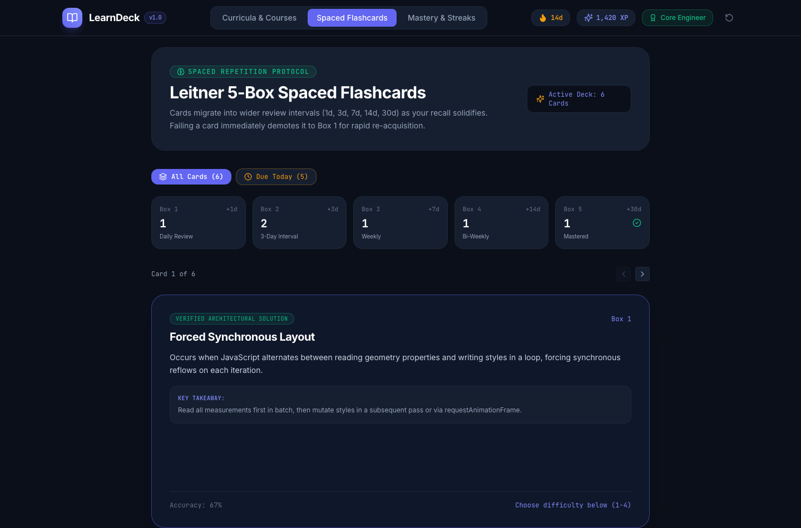
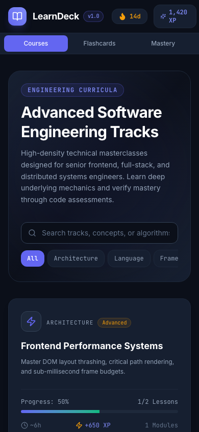

# LearnDeck — Technical Learning Platform & Spaced Repetition Engine

> A high-density, browser-first engineering education platform and Leitner 5-box spaced repetition engine built with **React 19**, **TypeScript 5.8** (Strict Mode), **Vite 6**, **Tailwind CSS v4**, and **Zustand 5**. Designed with a **Nordic Academic Editorial** aesthetic for senior engineers mastering advanced computer science, frontend systems, and distributed architecture.

[](https://react.dev)
[](https://www.typescriptlang.org)
[](https://tailwindcss.com)
[](https://github.com/pmndrs/zustand)
[](https://vitest.dev)
[](https://oxc-project.github.io)
[](https://www.netlify.com)



---

## 📐 Design Philosophy: Nordic Academic Editorial

LearnDeck rejects noisy consumer gamification in favor of **Nordic Academic Editorial** principles:
- **Midnight Slate Canvas**: Deep `#0B0F19` background paired with `#161F30` elevated card containers and `#334155` crisp architectural borders.
- **Nordic Indigo Accent**: `#6366F1` indigo for contemplative, high-signal focus states, progress meters, and primary CTAs.
- **Mastery Emerald**: `#10B981` rewarding correct recall, passed assessments, and verified solutions.
- **Streak Amber**: `#F59E0B` celebrating continuous daily study habits and active streak retention.
- **High-Density Typography**: Clean Inter for conceptual reading, matched with JetBrains Mono for code challenges and Leitner box metrics.

---

## 🗂️ Core Architecture



---

## 📸 Visual Walkthrough

### 1. Curricula & Engineering Tracks (`desktop-home.png`)
Primary dashboard featuring advanced engineering tracks (*Frontend Performance Systems*, *TypeScript Type Gymnastics*, *React 19 Architecture*, *Distributed Systems & Consensus*), search filtering, difficulty badges, and progress tracking.


### 2. Interactive Assessment & Code Prediction (`desktop-main-feature.png`)
Assessment runner evaluating conceptual understanding and code output prediction. Features syntax-highlighted code blocks, multi-choice evaluation, progress tracking, and detailed explanations.



### 3. Leitner 5-Box Spaced Repetition (`desktop-flashcards.png`)
Spaced repetition interface modeling the Leitner 5-box protocol ($1\text{d} \to 3\text{d} \to 7\text{d} \to 14\text{d} \to 30\text{d}$). Features 3D interactive flip card animation, recall confidence scoring (<kbd>Again</kbd>, <kbd>Hard</kbd>, <kbd>Good</kbd>, <kbd>Easy</kbd>), and keyboard shortcuts (<kbd>Space</kbd> / <kbd>1-4</kbd>).



### 4. Responsive Mobile Experience (`mobile-home.png`)
Adaptive 390px mobile interface with touch-friendly navigation, mobile streak counter, and responsive syllabus drawer.



---

## 🛠️ Tech Stack & Tooling

- **Core**: React 19, TypeScript 5.8 (`verbatimModuleSyntax`, strict mode)
- **Styling**: Tailwind CSS v4 (`@tailwindcss/vite`, CSS `@theme` variables)
- **State**: Zustand 5 (zero-boilerplate store with local persistence)
- **Icons**: Lucide React
- **Testing**: Vitest 3.0 + `@testing-library/react` (22 unit tests)
- **Visual Validation**: Playwright (automated Chromium screenshots in 1440px desktop & 390px mobile)
- **Linter**: Oxlint (instant Rust-based linter with 0 warnings)
- **Deployment**: Netlify (`netlify.toml` with SPA redirects and security headers)

---

## 🧪 Testing & Quality

LearnDeck includes 22 unit tests verifying algorithmic engines, user scoring, card migrations, and state persistence:

```bash
# Run Vitest unit tests
pnpm test

# Run Oxlint static analysis
pnpm lint

# Build production bundle
pnpm build

# Capture automated Playwright screenshots
pnpm screenshots
```

### Test Coverage Highlights:
- **Leitner Engine**: Correct interval math ($B_1 \dots B_5$), demotion to Box 1 on failure, box promotions on good/easy ratings, card due date detection.
- **Quiz Evaluator**: Single-choice evaluation, multi-choice set equality (order independent), score percentage, pass/fail thresholding, perfect score 50 XP bonus.
- **Progress Store**: Lesson completion without duplicate credit, streak tracking, daily activity ledger updates, 1-click demo data reset.
- **Course Catalog**: Filter pills, live search queries, and lesson modal launches.

---

## 📦 Getting Started

### Installation

```bash
pnpm install
```

### Development Server

```bash
pnpm dev
```

### Production Build

```bash
pnpm build
```

---

## 📄 License

MIT © Abderraouf SAHEB
