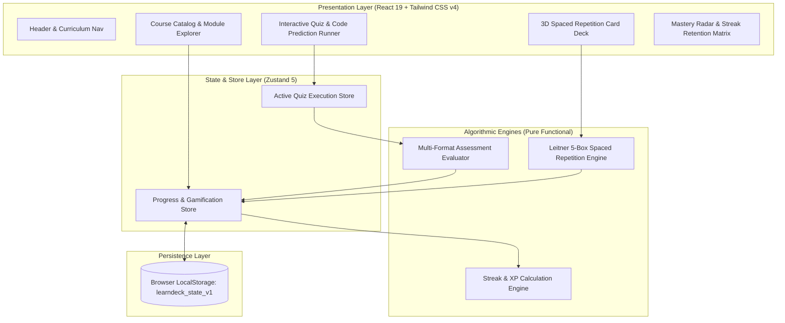

# Architecture & System Design — LearnDeck

## 1. System Overview

LearnDeck is an interactive technical education and spaced repetition platform engineered for professional software engineers. It models progressive concept mastery through structured curricula, interactive multi-format assessments (including code prediction execution), and a deterministic Leitner 5-box spaced repetition engine.

---

## 2. Core Domain Data Models

### 2.1 Course Curriculum Structure
- **Track / Course**: Top-level curriculum domain (e.g., *Frontend Performance Systems*, *TypeScript Type Gymnastics*).
- **Module**: Thematic learning unit within a course (e.g., *Critical Rendering Path & Layout Thrashing*).
- **Lesson**: Atomic theoretical guide with markdown syntax, architectural diagrams, and interactive key takeaways.
- **Quiz**: Multi-question assessment containing single-choice, multiple-choice, code snippet prediction, and conceptual matching.

### 2.2 Leitner 5-Box Spaced Repetition Model
Cards reside in one of 5 progressive mastery boxes ($B_1 \dots B_5$):
- **Box 1 (Daily)**: New or recently failed cards ($\Delta t = 1\text{ day}$).
- **Box 2 (3-Day Interval)**: Emerging familiarity ($\Delta t = 3\text{ days}$).
- **Box 3 (Weekly)**: Solid conceptual grasp ($\Delta t = 7\text{ days}$).
- **Box 4 (Bi-Weekly)**: Long-term retention ($\Delta t = 14\text{ days}$).
- **Box 5 (Mastered - Monthly)**: Deep architectural fluency ($\Delta t = 30\text{ days}$).

**Review State Transition Function**:
$$
f(B_i, \text{rating}) = \begin{cases}
\min(5, i + 1) & \text{if rating } \in \{\text{Good}, \text{Easy}\} \\
i & \text{if rating } = \text{Hard} \\
1 & \text{if rating } = \text{Again}
\end{cases}
$$

---

## 3. Storage & Privacy Strategy

- **Zero-Telemetry Principle**: All study session timestamps, card confidence scores, quiz results, and study streaks are processed client-side.
- **Atomic Local Persistence**: Synced reactively to `localStorage` under `learndeck_state_v1`.
- **Instant Demo Reset**: 1-click restoration of seeded courses, flashcards, completed modules, and realistic 14-day study streaks.
